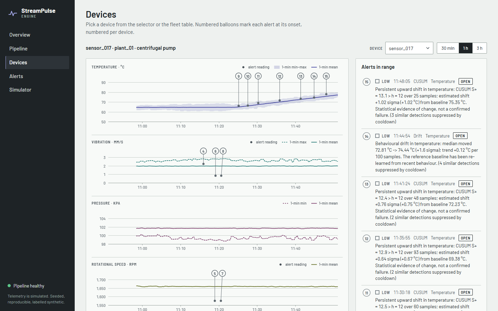
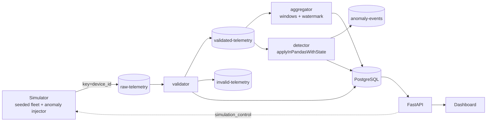
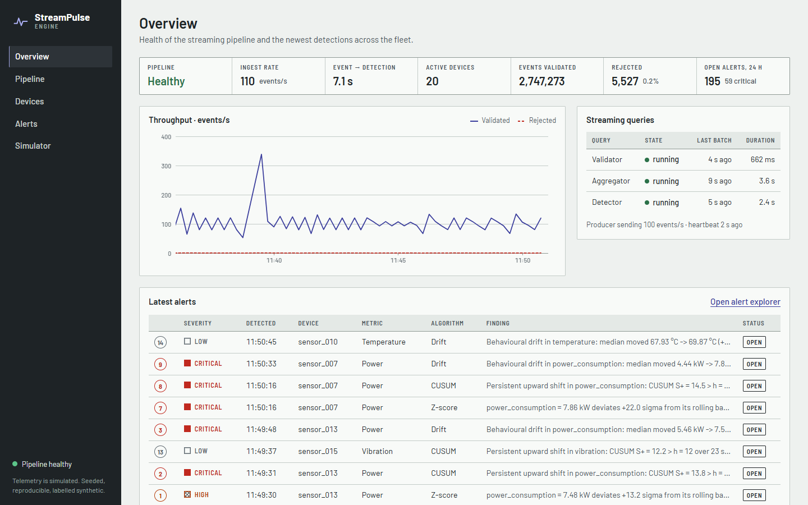
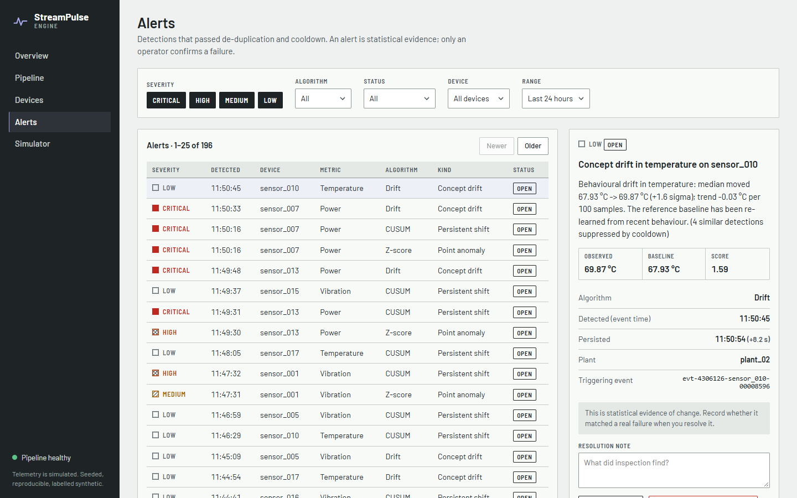
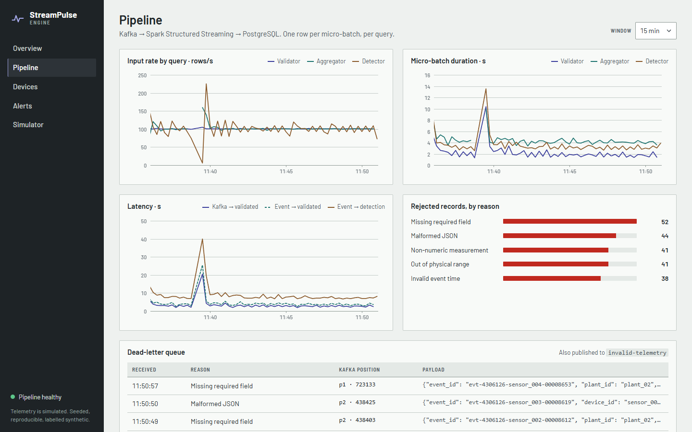
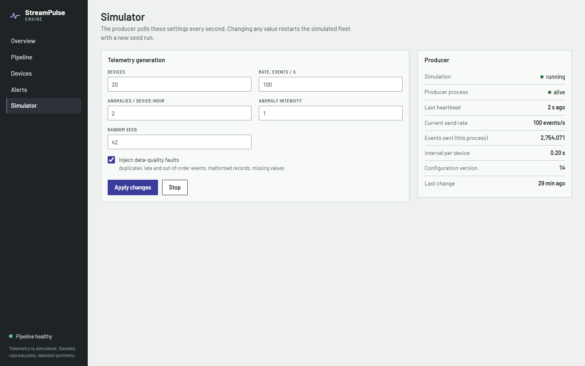
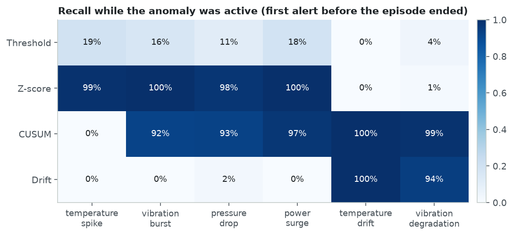
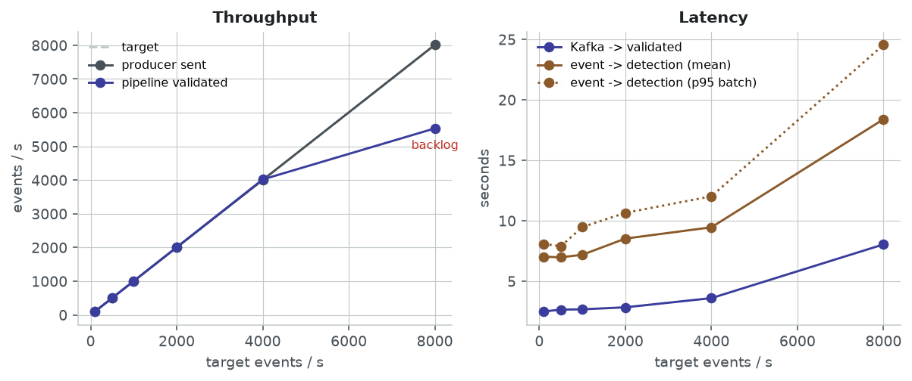

# StreamPulse Engine

**Real-time distributed telemetry streaming and adaptive anomaly detection.**
Kafka (KRaft) → PySpark Structured Streaming → PostgreSQL → FastAPI, with four detectors
(threshold, z-score, CUSUM, two-window drift) running statefully inside Spark. Each one is
benchmarked against injected ground truth.



```bash
docker compose up --build        # then open http://localhost:8080
```

---

## What it does

A seeded simulator plays a fleet of industrial machines (temperature, vibration, pressure,
RPM, power) and injects six kinds of anomaly, from single spikes to slow degradation. It also
injects the data problems real pipelines see: duplicates, late and out-of-order events,
missing values and malformed records. The pipeline:

1. **Ingests** events into Kafka with `acks=all` and idempotent producers, keyed by device.
2. **Validates** them in Spark and routes bad records to a dead-letter topic and table,
   each with a reason.
3. **Aggregates** 1-minute event-time windows sliding every 15 s, with a 2-minute watermark
   and watermark-bounded de-duplication.
4. **Detects** anomalies with `applyInPandasWithState`. Each device's detector state is
   checkpointed with the Kafka offsets, so a restart resumes exactly where it stopped.
5. **Persists** metrics and alerts idempotently (effectively-once) and publishes alerts to Kafka.
6. **Serves** pipeline health, telemetry and an alert workflow (acknowledge, resolve,
   confirm or reject a failure) through FastAPI and a dashboard.

Every alert says *why* it fired, for example: "Persistent upward shift in temperature: CUSUM
S+ = 12.0 > h = 12 over 60 samples; estimated shift +0.70 sigma (+0.71 °C) from baseline
64.33 °C. Statistical evidence of change, not a confirmed failure."

## Architecture



Three independent streaming queries, each with its own checkpoint, trigger and failure
domain. Details and design decisions: [docs/architecture.md](docs/architecture.md) ·
[docs/data_flow.md](docs/data_flow.md).

| Layer | Technology |
|---|---|
| Broker | Apache Kafka 4.0.2, KRaft (no ZooKeeper) |
| Processing | Apache Spark 4.0.1 Structured Streaming, PySpark, standalone cluster |
| Detection | Pure-Python detectors, run with `applyInPandasWithState` (Arrow) |
| Storage | PostgreSQL 16 (optional TimescaleDB migration) |
| API | FastAPI, psycopg 3 connection pool |
| UI | Static HTML/CSS/JS, hand-written SVG charts, served by nginx |
| Infra | Docker Compose, 9 services, one command |

## Quickstart

Requirements: Docker with about 6 GB of memory available to it.

```bash
git clone <your-fork-url> StreamPulse-Engine && cd StreamPulse-Engine
cp .env.example .env              # optional: change rates, ports, Spark resources
docker compose up --build -d
```

| URL | What |
|---|---|
| http://localhost:8080 | Dashboard |
| http://localhost:8000/docs | API (OpenAPI) |
| http://localhost:8081 | Spark master UI |
| http://localhost:4040 | Spark driver UI (streaming queries) |
| `localhost:29092` | Kafka from the host |
| `localhost:5432` | PostgreSQL (`streampulse` / `streampulse`) |

The simulator starts automatically at 100 events/s from 20 devices. Detectors learn each
device's baseline first (about 5 minutes at the default rate), then alerts appear.

```bash
docker compose logs -f stream-processor     # the streaming job
make psql                                   # SQL shell
docker compose down                         # stop, keep data
docker compose down -v                      # stop and delete everything
```

## Dashboard

| | |
|---|---|
|  |  |
| **Overview**: pipeline status, ingest rate, latency, newest alerts with their per-device numbers | **Alerts**: filter, read the reasoning, acknowledge, resolve as a confirmed failure or a false alarm |
|  |  |
| **Pipeline**: rows/s and micro-batch duration per query, latency, rejected records by reason | **Simulator**: change devices, rate, anomaly rate, intensity and seed while it runs |

On the device view, each alert is a numbered balloon anchored at its onset (a drawing-set
convention). Hovering a balloon or its list entry highlights both.

## API

| Endpoint | Method | Purpose |
|---|---|---|
| `/health` | GET | API and database liveness |
| `/pipeline/status` | GET | State of each streaming query + producer heartbeat |
| `/pipeline/metrics` | GET | Throughput, latency, batch durations, rejections (time series) |
| `/pipeline/dead-letters` | GET | Most recent rejected records |
| `/devices` | GET | Devices with latest window metrics and open alerts |
| `/devices/{id}/metrics` | GET | Sliding-window history |
| `/alerts` | GET | Filter by device, severity, algorithm, status, kind, metric, time range |
| `/alerts/summary` | GET | Distribution by severity / algorithm / kind / status |
| `/alerts/evaluation` | GET | Live precision / recall against injected ground truth |
| `/alerts/{id}` | GET | Alert details |
| `/alerts/{id}/acknowledge` | POST | Acknowledge |
| `/alerts/{id}/resolve` | POST | Resolve; `confirmed_failure: true/false/null` |
| `/simulation/start` | POST | Start or reconfigure (`rate`, `devices`, `seed`, `anomaly_rate`, `intensity`, `data_quality`) |
| `/simulation/stop` | POST | Stop generation |

```bash
curl -s "localhost:8000/alerts?severity=critical&algorithm=cusum&limit=5" | jq '.items[].description'
curl -s -X POST localhost:8000/simulation/start -H 'content-type: application/json' -d '{"rate": 500}'
```

## Detection

| Detector | Catches | Mechanism |
|---|---|---|
| Threshold | extreme values | fixed operating limits |
| Z-score | point anomalies | EWMA baseline, robust (clipped) updates, \|Z\| > 5 |
| CUSUM | small persistent shifts | two-sided CUSUM in sigma units, robust increments, re-baselining |
| Drift | changes in distribution (level *or* spread) | reference vs recent window, median / MAD, adapts after drift |

Results from the reproducible offline benchmark (3 seeds × 6 h × 20 devices, 1.3 M events,
508 injected episodes), using the same code that runs in Spark:

| Detector | Precision | False alerts / device-hour | Sudden faults caught¹ | Gradual drifts caught **while developing**² | Median delay |
|---|---:|---:|---:|---:|---:|
| Threshold | 100% | 0.000 | 11-19% | 0-4% | 0 s |
| Z-score | 98.7% | 0.017 | **98-100%** | **0-1%** | 0 s |
| CUSUM | 97.5% | 0.072 | 92-97% (spikes 0%, by design) | **99-100%** | 4 s |
| Drift | 94.1% | 0.072 | 0-45% | **94-100%** | 329 s |

¹ vibration bursts, pressure drops, power surges, temperature spikes · ² temperature drift and
vibration degradation, first alert before the episode ended. Full tables:
[benchmarks/results/REPORT.md](benchmarks/results/REPORT.md). The engine runs at about 32,000
events/s on one core with all four detectors.



Each detector covers a blind spot of the others. Z-score catches every sudden fault but
absorbs slow drift into its adaptive baseline. CUSUM and drift catch gradual degradation
minutes before a fixed limit would. CUSUM deliberately ignores single spikes. CUSUM's
parameters were tuned from evidence (0.77 → 0.07 false alerts per device-hour); see
[docs/detection_algorithms.md](docs/detection_algorithms.md).

## Performance

Live load test on a laptop (Docker Desktop, 4 CPUs / 7.7 GiB shared by every container on the
host; Spark: **one worker with 2 cores**), 50 devices, data-quality faults on:

| Target events/s | Validated events/s | Event → detection (mean / p95 batch) | Spark worker CPU | Keeps up |
|---:|---:|---:|---:|:---:|
| 100 | 101 | 7.0 s / 8.1 s | 57% | yes |
| 1,000 | 1,002 | 7.2 s / 9.5 s | 47% | yes |
| 2,000 | 2,004 | 8.5 s / 10.7 s | 94% | yes |
| 4,000 | 4,019 | 9.5 s / 12.0 s | 149% | yes |
| 8,000 | 5,533 | 18.4 s / 24.5 s | 250% | **no**: backlog grows |

The pipeline sustains **4,000 events/s** on two Spark cores and saturates at about 5,500 events/s.
Latency is dominated by micro-batch scheduling (2 s validator trigger + 5 s detector
trigger), not by detection, which runs at about 32k events/s per core.



Full method, charts and caveats: [docs/benchmarking.md](docs/benchmarking.md) and
[benchmarks/results/REPORT.md](benchmarks/results/REPORT.md).

## Reliability

* **Effectively-once persistence.** Every table written by Spark has a deterministic key
  (`alert_id = sha1(device|metric|algorithm|event_id)`, window keys, `topic-partition-offset`
  for dead letters) and is written with `ON CONFLICT`, so replayed micro-batches are harmless.
  Kafka sinks are at-least-once, and the project does not claim end-to-end exactly-once.
* **Checkpointed state.** Offsets, window state, de-duplication state and per-device detector
  state are checkpointed together on a shared volume. Restarting containers resumes processing.
* **Dead-lettering.** Rejected records keep their reason, raw payload and Kafka position,
  in a topic (7-day retention) and a table.
* **Backpressure.** `maxOffsetsPerTrigger` bounds micro-batches during catch-up.

Measured with `python -m benchmarks.recovery_test` (each component down for 30 s at 100 events/s):

| Failure | Recovered after restart | Windows complete | Event coverage | Duplicate alerts |
|---|---:|---:|---:|---:|
| Spark driver SIGKILL | 30 s | 180/180 | 99.5% | 0 |
| Kafka broker stop/start | 23 s | 160/160 | 99.5% | 0 |
| PostgreSQL stop/start | 11 s | 160/160 | 99.5% | 0 |

The 0.5% gap is the same as in normal operation: injected duplicates, malformed records and
events deliberately delayed past the watermark. No data was lost.

## Testing

```bash
pip install -e ".[dev]"
make test               # 46 unit tests: simulator, validation rules, detectors, alerts, replay determinism
make test-spark         # Spark transformations, run inside the Spark image (no local Java needed)
make test-integration   # end-to-end against the running stack (dead letter, alert lifecycle, dedup)
```

`tests/test_transformations.py` runs the same validation fixtures through the Spark
implementation and the pure-Python reference and asserts they agree.
`tests/test_alerts.py::test_engine_replay_is_deterministic` checkpoints detector state
halfway through a stream, replays the second half twice and asserts identical alert ids.
That property is what makes the database writes idempotent.

## Repository layout

```text
config/       Kafka, Spark and detection settings (env-driven) + detection_config.yaml
producer/     simulator, sensor model, anomaly + data-quality injection, event schema
streaming/    Spark jobs: validation, transformations, windowing, detection stage, sinks
detection/    detectors, alert manager, detection engine (no Spark imports)
api/          FastAPI app: routes, services (SQL), schemas
database/     schema.sql + optional TimescaleDB migration
dashboard/    static monitoring UI (served by nginx)
benchmarks/   offline detection evaluation, live load test, report generator, results/
tests/        unit, Spark and integration tests
docs/         architecture, data flow, detection algorithms, benchmarking
docker/       Dockerfiles, nginx config
```

## Configuration

Everything is set through environment variables (`.env.example`) and
`config/detection_config.yaml`. Highlights:

| Variable | Default | |
|---|---|---|
| `SIM_DEVICES`, `SIM_RATE`, `SIM_SEED` | 20, 100, 42 | fleet size, events/s, reproducibility |
| `SIM_ANOMALY_RATE`, `SIM_INTENSITY` | 2.0, 1.0 | anomaly episodes per device-hour, magnitude multiplier |
| `WINDOW_DURATION`, `WINDOW_SLIDE`, `WATERMARK_DELAY` | 1 minute, 15 seconds, 2 minutes | event-time processing |
| `SPARK_WORKER_CORES`, `SPARK_WORKER_MEMORY` | 2, 2g | cluster size |
| `SPARK_SHUFFLE_PARTITIONS` | 2 | state partitions per stateful operator (`make reset-checkpoints` after changing) |
| `STATE_STORE_PROVIDER` | hdfs | `hdfs` (in-memory, lowest overhead) or `rocksdb` |

## Limitations and next steps

* Single Kafka broker and a single Spark worker: the topology is distributed, the hardware is
  a laptop. More workers means `docker compose up --scale spark-worker=N` plus raising
  `spark.cores.max`, but every number above was measured with one 2-core worker.
* Micro-batch latency is several seconds by design (2-10 s triggers, three queries sharing
  two cores). Spark's real-time mode or a lower-level engine would be the route to sub-second.
* Late events that are still inside the watermark reach the detectors in arrival order, not
  event-time order.
* The drift detector is a robust two-window baseline. Research methods (evolving-stream
  clustering, AbruptCUSUM-style detectors) can be added behind the same `BaseDetector`
  interface and scored with the same benchmark.
* All telemetry is simulated.

## License

MIT. Barlow fonts are under the SIL Open Font License (`dashboard/fonts/OFL.txt`).
