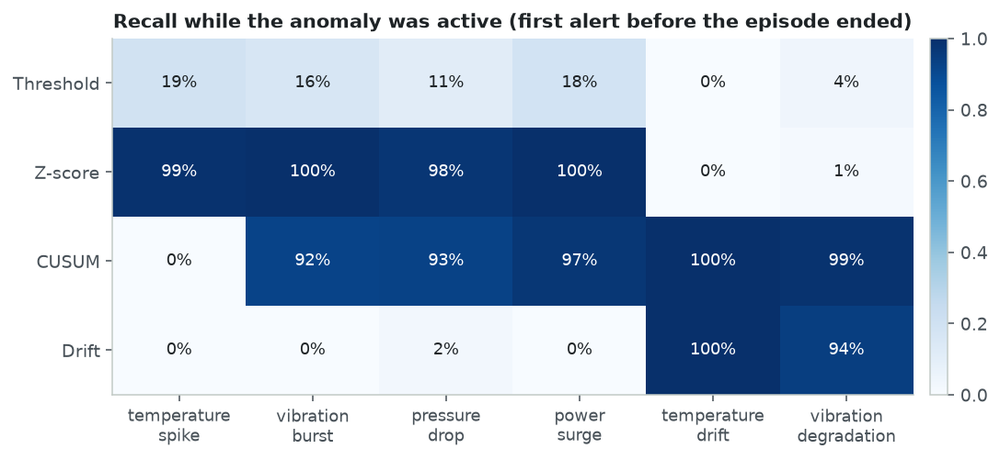
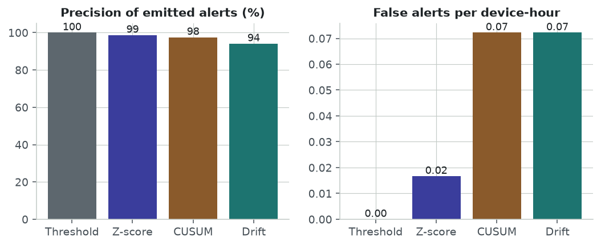
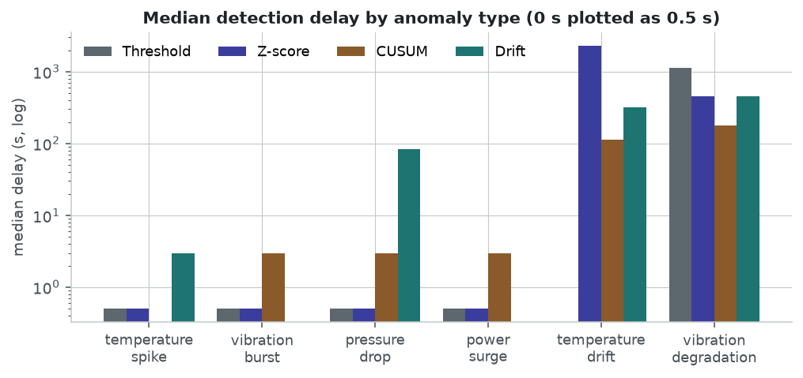
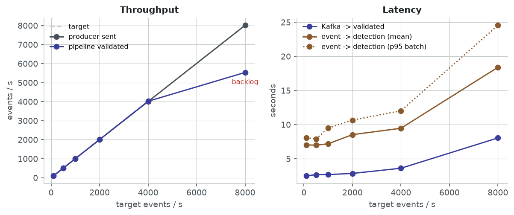
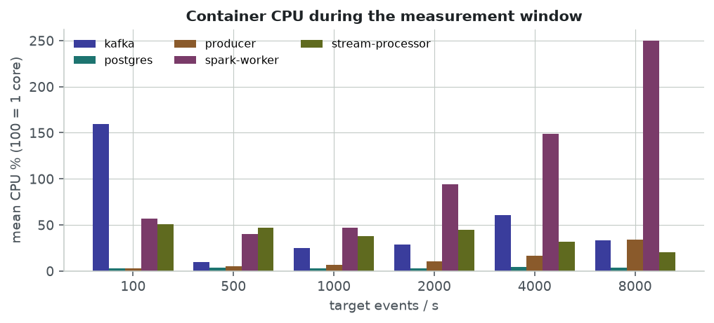

# StreamPulse benchmark report

Generated by `python -m benchmarks.generate_reports`. All numbers are measurements on the machine described below, not guarantees.

## Detection quality (offline, reproducible)

3 seeds x 6 h x 20 devices (1,296,000 events, 508 injected anomaly episodes), anomaly rate 2.0 per device-hour, grace 180 s. Engine throughput: **32,625 events/s** on one core with all four detectors.

| Detector | Alerts | Precision | Recall (all types) | False-positive rate | False alerts / device-hour | Median delay |
|---|---:|---:|---:|---:|---:|---:|
| threshold | 74 | 100.0% | 11.8% | 0.0000% | 0.000 | 0 s |
| zscore | 464 | 98.7% | 84.4% | 0.0001% | 0.017 | 0 s |
| cusum | 1053 | 97.5% | 75.6% | 0.0004% | 0.072 | 4 s |
| drift | 441 | 94.1% | 38.2% | 0.0017% | 0.072 | 329 s |

Recall by anomaly type (median detection delay in brackets):

| Anomaly type | Category | Episodes | threshold | zscore | cusum | drift |
|---|---|---:|---:|---:|---:|---:|
| temperature_spike | sudden | 109 | 19% (0 s) | 99% (0 s) | 0% | 1% (3 s) |
| vibration_burst | sudden | 92 | 16% (0 s) | 100% (0 s) | 92% (3 s) | 0% |
| pressure_drop | sudden | 82 | 11% (0 s) | 98% (0 s) | 94% (3 s) | 45% (83 s) |
| power_surge | sudden | 65 | 18% (0 s) | 100% (0 s) | 97% (3 s) | 0% |
| temperature_drift | gradual | 88 | 0% | 94% (2293 s) | 100% (114 s) | 100% (318 s) |
| vibration_degradation | gradual | 72 | 4% (1130 s) | 1% (456 s) | 99% (177 s) | 94% (452 s) |

Gradual anomalies detected *while still developing* (first alert before the episode ended; the recall above also credits alerts on the snap back to baseline at the end of an episode):

| Anomaly type | threshold | zscore | cusum | drift |
|---|---:|---:|---:|---:|
| temperature_drift | 0% | 0% | 100% | 100% |
| vibration_degradation | 4% | 1% | 99% | 94% |

## Live pipeline load test

Docker Desktop with 4 CPUs / 7.7 GiB shared by every container on the host; Spark: 1 worker, 50 simulated devices, data-quality faults on. Warm-up 90 s, measurement window 120 s per rate.

| Target ev/s | Producer ev/s | Validated ev/s | Kafka→validated | Event→detection (mean / p95) | Batch validator / aggregator / detector | Spark worker CPU | Sustainable |
|---:|---:|---:|---:|---:|---:|---:|:---:|
| 100 | 100 | 101 | 2.5 s | 7.0 s / 8.1 s | 1.6 s / 3.9 s / 3.1 s | 57% | yes |
| 500 | 501 | 501 | 2.6 s | 7.0 s / 7.9 s | 1.7 s / 4.2 s / 3.1 s | 40% | yes |
| 1000 | 1003 | 1002 | 2.7 s | 7.2 s / 9.5 s | 1.7 s / 4.4 s / 3.1 s | 47% | yes |
| 2000 | 2006 | 2004 | 2.8 s | 8.5 s / 10.7 s | 1.9 s / 4.6 s / 3.1 s | 94% | yes |
| 4000 | 4004 | 4019 | 3.6 s | 9.5 s / 12.0 s | 2.6 s / 5.2 s / 4.2 s | 149% | yes |
| 8000 | 8013 | 5533 | 8.0 s | 18.4 s / 24.5 s | 7.6 s / 7.8 s / 9.9 s | 250% | **no** |

## Failure recovery

Simulator at 100 events/s, 20 devices. Completeness = events counted in every 1-minute window spanning the failure vs. what the simulator sent; the ~0.5% gap is the injected duplicates, malformed records and events delayed beyond the watermark, i.e. the same as in normal operation.

| Failure | Down for | Recovered after restart | Resumed from checkpoint | Windows | Event coverage | Duplicate alert keys |
|---|---:|---:|:---:|---:|---:|---:|
| Spark driver SIGKILL | 30 s | 30 s | yes | 180/180 | 99.5% | 0 |
| Kafka broker stop/start | 30 s | 23 s | yes | 160/160 | 99.5% | 0 |
| PostgreSQL stop/start | 30 s | 11 s | yes | 160/160 | 99.5% | 0 |

Alerts less than 1 s apart on the same device/metric/algorithm were all a severity escalation on a different event (the cooldown lets a more severe detection through), not duplicates.
