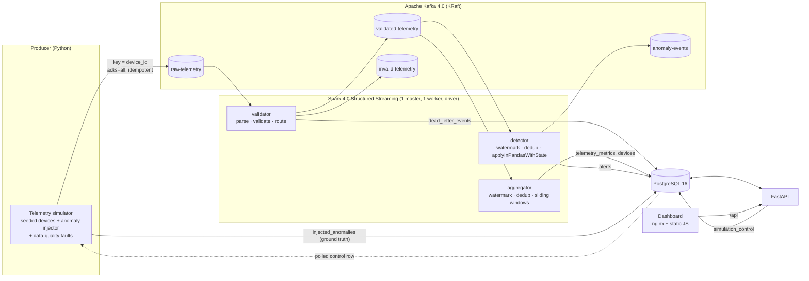

# Architecture

## Components

| Service | Image | Role |
|---|---|---|
| `kafka` | `apache/kafka:4.0.2` | Single-node broker + controller in KRaft mode. Kafka 4.0 removed ZooKeeper entirely. |
| `kafka-init` | same | Creates the four topics (6 partitions, retention 24 h; 7 days for `invalid-telemetry`), then exits. |
| `postgres` | `postgres:16-alpine` | Metrics, alerts, dead letters, ground truth and the simulator control row. Schema in `database/schema.sql`. |
| `spark-master`, `spark-worker` | `streampulse/spark` (built from `apache/spark:4.0.1-python3`) | Standalone cluster. The worker shares the checkpoint volume with the driver. |
| `stream-processor` | same | The driver: `spark-submit streaming/main.py` in client mode against the master. |
| `producer` | `streampulse/producer` | Simulator + Kafka producer (`confluent-kafka`), controlled through `simulation_control`. |
| `api` | `streampulse/api` | FastAPI + psycopg 3 connection pool. Reads only from PostgreSQL. |
| `dashboard` | `nginx:1.27-alpine` | Serves `dashboard/` and proxies `/api/*` to the API (no CORS involved). |

One image serves the Spark master, the worker and the driver. PySpark requires the
driver and the executors to run the same Python with the same libraries, and a shared image
removes that whole class of "works on the driver, fails on the executor" bugs. The Kafka
connector jars are baked into the image so nothing is downloaded at job start.

## Design decisions

**Three independent streaming queries instead of one.** Validation, aggregation and
detection have different trigger intervals (2 s / 10 s / 5 s), different state and different
failure modes. Each has its own checkpoint, so a bug or restart in detection never forces
validation to reprocess. The `validated-telemetry` topic between them is a real contract:
other consumers could subscribe to clean data without touching Spark.

**Detection state lives in Spark, not in an external store.** `applyInPandasWithState`
groups the stream by `device_id`. Every device is processed by exactly one task per
micro-batch, so detector state needs no locking. The state (CUSUM sums, EWMA baselines,
drift windows, alert cooldowns) is a JSON document in `GroupState`. It is checkpointed
atomically with the Kafka offsets, so after a crash the detectors resume with exactly the
state that matches the last committed offset. There is no Redis and no second source of truth.

**Detectors are pure Python over explicit state.** `detection/` has no Spark imports. The
same code runs inside `applyInPandasWithState`, in the offline benchmark and in unit tests.
The benchmark therefore measures exactly what production runs.

**The API reads PostgreSQL, never Spark.** The streaming job and the API can fail, restart
and scale independently. Pipeline health is derived from what each query last committed
(`pipeline_metrics`) and from the producer heartbeat.

**Small outputs are written from the driver, events stay distributed.** Window aggregates,
alerts and rejected records are bounded by fleet size, not event volume, so `foreachBatch`
collects them and writes them in one PostgreSQL transaction. Raw event volume never reaches
the driver: Kafka → Spark → Kafka stays on the executors. On the reference machine this
replaced a Python-worker stage per table per batch and cut micro-batch time roughly 3x
(see [benchmarking.md](benchmarking.md)).

**State store: in-memory HDFS-backed by default, RocksDB on demand.** For this workload
(tens of devices, two-minute dedup windows) the HDFS-backed provider has the lowest
per-batch overhead. `STATE_STORE_PROVIDER=rocksdb` switches to RocksDB with changelog
checkpointing, the right choice once state outgrows executor memory.

**Simulator control via a database row, not an RPC.** The API writes `simulation_control`;
the producer polls it every second. No extra port, no extra protocol, and the control state
survives restarts of either side.

## Delivery semantics

| Hop | Guarantee | Mechanism |
|---|---|---|
| Producer → Kafka | no producer-side duplicates | `acks=all`, `enable.idempotence=true` |
| Kafka → Spark | exactly-once *reading* | offsets tracked in each query's checkpoint |
| Spark → Kafka sinks | at-least-once | `foreachBatch` replays a failed batch; consumers dedupe on `event_id` / `alert_id` |
| Spark → PostgreSQL | **effectively-once** | deterministic keys + `ON CONFLICT`; one transaction per batch per table group |
| Duplicates in the data itself | removed | `dropDuplicatesWithinWatermark(event_id)` with a 2-minute watermark |

The project deliberately does **not** claim end-to-end exactly-once: the Kafka sinks can
carry duplicates after a replay. Persistence is idempotent, so the database never does.

## Failure recovery

* **Spark driver crash / restart:** `restart: on-failure` restarts the driver. Each query
  resumes from its checkpoint (offsets + state). Batches that were written but not committed
  are replayed with the same `batch_id` and data, and idempotent writes absorb them.
* **Kafka restart:** the producer buffers and retries (librdkafka). Spark queries wait for the
  broker. `failOnDataLoss=false` lets a query continue with a logged gap if retention deleted
  data during a long outage.
* **PostgreSQL restart:** a failing `foreachBatch` fails the micro-batch, the query
  restarts, and the batch is replayed once the database is back. Pipeline metrics writes are
  best-effort and never fail the data path.
* **Changing the number of shuffle partitions** requires new checkpoints (state is
  partitioned): `make reset-checkpoints`.
